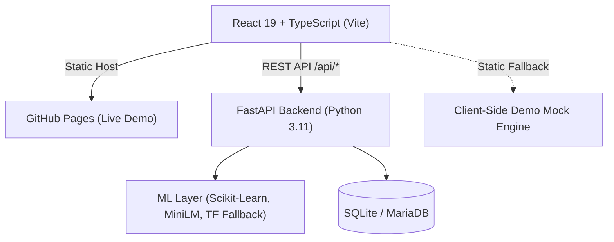

# 🧠 MindGuard — AI Mental Health Support Platform

[](https://0323dxd.github.io/mindguard/)
[](https://react.dev/)
[](https://www.typescriptlang.org/)
[](https://fastapi.tiangolo.com/)
[](https://opensource.org/licenses/MIT)

> **MindGuard** is a hybrid AI-powered mental health companion and institutional analytics platform engineered for university students and guidance counselors. It pairs real-time, culturally attuned NLP chat support with an administrative triage dashboard for proactive student wellness monitoring.

🌐 **Live Portfolio Demo:** [https://0323dxd.github.io/mindguard/](https://0323dxd.github.io/mindguard/)

---

## 🔑 Demo Access Credentials

The web application includes **standalone portfolio demo mode** on GitHub Pages, allowing full exploration of both administrative tiers and student features:

| Role | Email | Password | Access Level |
| :--- | :--- | :--- | :--- |
| **Primary Admin** | `adminkapeeryu@edu.ph` | `adminpiyu123` | **SuperAdmin Dashboard**: System administration, staff management, audit & AI decision logs |
| **Staff Counselor** | `kapeeryu@mindguard.edu.ph` | `kapeeryu123` | **Staff Analytics Dashboard**: Real-time mood analytics, risk monitoring, crisis alerts, student overview |
| **Student (Demo)** | Any `@lspu.edu.ph` email | Any password | **Student Portal**: AI companion chat, encrypted journal, wellness check-in, daily affirmations |

---

## ✨ Key Features

### 1. Hybrid AI Conversational Companion
- **Multi-layered NLP Analysis**: Analyzes student messages across intent recognition, sentiment scoring, and emotional state trends.
- **Multilingual & Culturally Attuned**: Supports English, Filipino, and Taglish communication naturally.
- **Crisis Triage & Immediate Escalation**: Automatically surfaces emergency hotline referrals (e.g., NCMH 1553, Hopeline) when detecting high-risk distress signals.

### 2. Guidance & Counselor Analytics Dashboard
- **Aggregate Mood Analytics**: Real-time visualization of campus emotional climates across various student cohorts.
- **Risk Trend Monitoring**: Time-series charts tracking mild, moderate, and elevated distress indicators.
- **Actionable Crisis Alerts**: Action logs with acknowledgment and review workflows for counselors.

### 3. Student Wellness Toolkit
- **Client-Side Encrypted Journal**: End-to-end encrypted reflection logging utilizing the Web Cryptography API (`AES-GCM-256`).
- **Interactive Mood Tracker**: Visual mood logging with historical timeline visualization.
- **Adaptive Daily Affirmations**: Curated affirmations tailored to student mental wellbeing.

---

## 🛠️ Architecture & Tech Stack



- **Frontend**: React 19, TypeScript, Vite, React Router 7, Framer Motion, Recharts, Lucide/FontAwesome Icons.
- **Backend**: Python 3.11, FastAPI, Uvicorn, Pydantic, SQLAlchemy.
- **Machine Learning**: Scikit-learn, Sentence-Transformers (`all-MiniLM-L6-v2`), NLTK VADER.
- **Security & Privacy**: Web Cryptography API (`AES-GCM-256`), password hashing via `bcrypt`.

---

## 🚀 Running Locally

### 1. Clone the Repository
```bash
git clone https://github.com/0323DxD/MindGuard.git
cd MindGuard
```

### 2. Frontend Setup
```bash
# Install dependencies
npm install

# Start Vite dev server
npm run dev
```
The frontend will be running at [http://localhost:5173/mindguard/](http://localhost:5173/mindguard/).

### 3. Backend Setup (Optional for Full AI Pipeline)
```bash
# Install Python dependencies
pip install -r backend/requirements.txt

# Run database setup & seed
python backend/migrate_and_seed.py

# Launch FastAPI server
python backend/main.py
```
The backend will listen on [http://127.0.0.1:8000](http://127.0.0.1:8000).

---

## 📄 License
This project is open source and available under the [MIT License](LICENSE).
